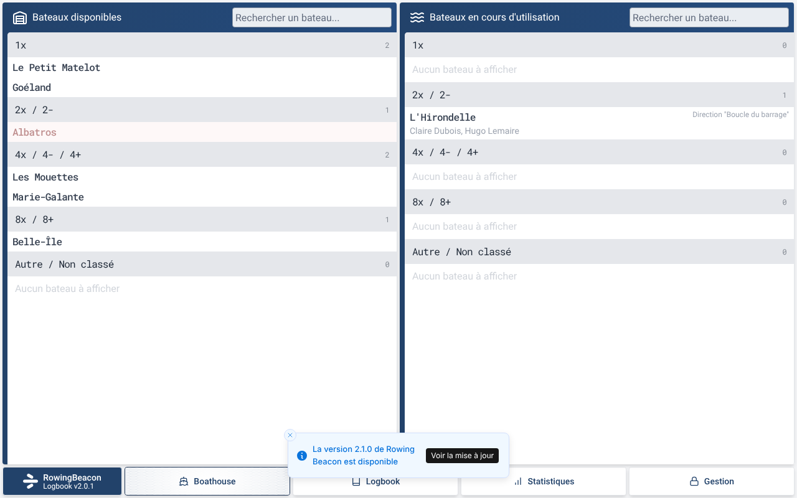
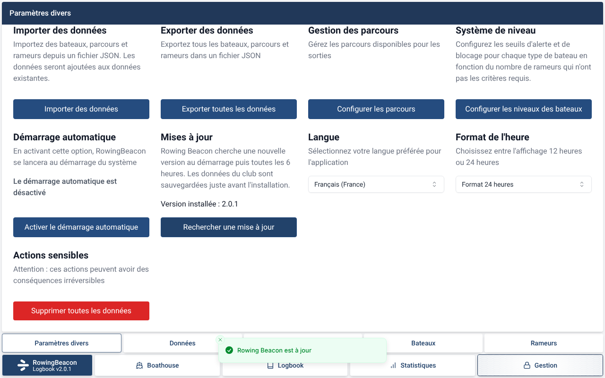
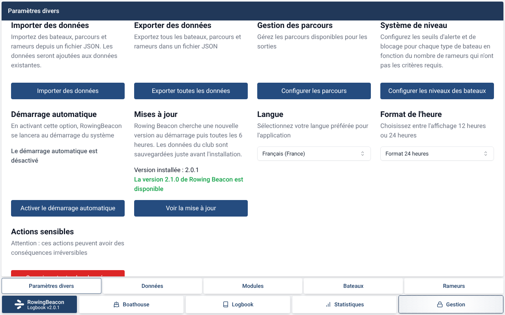
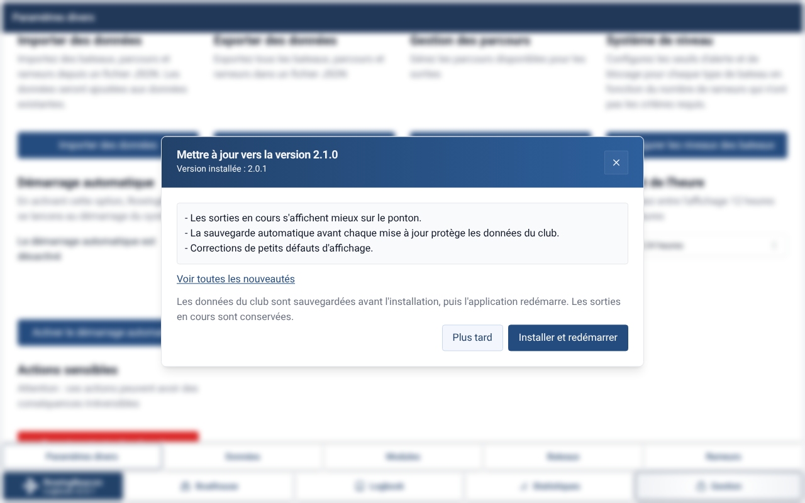
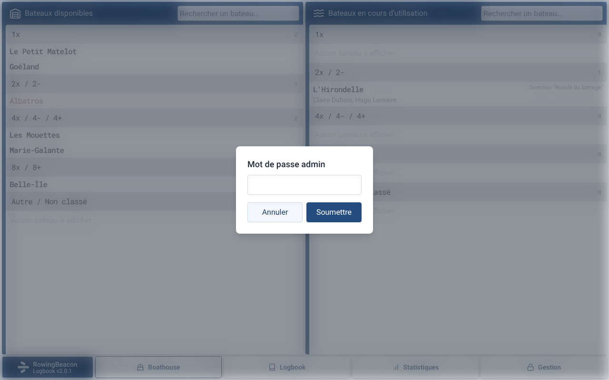
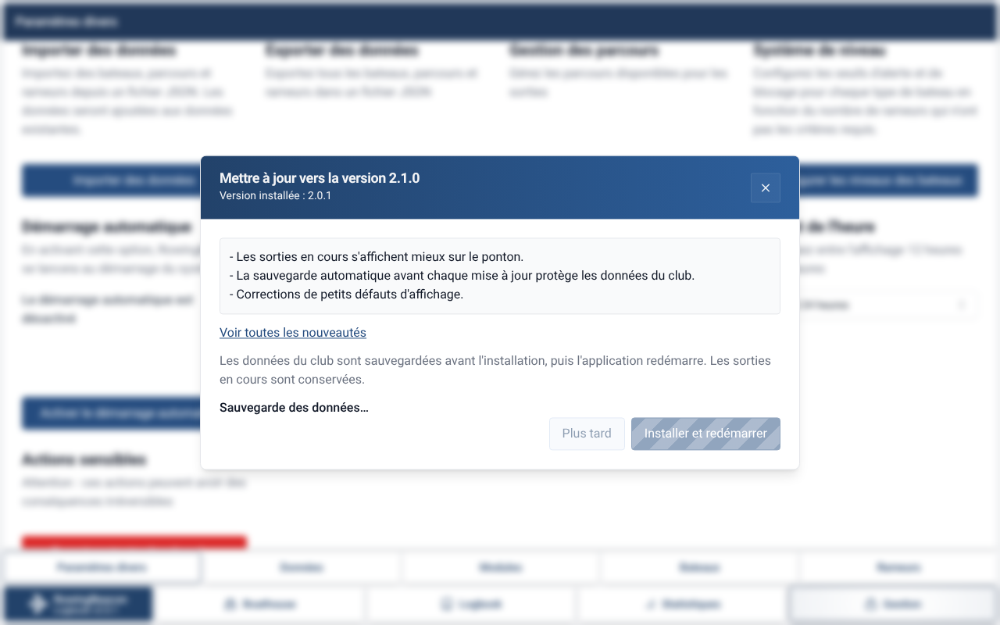
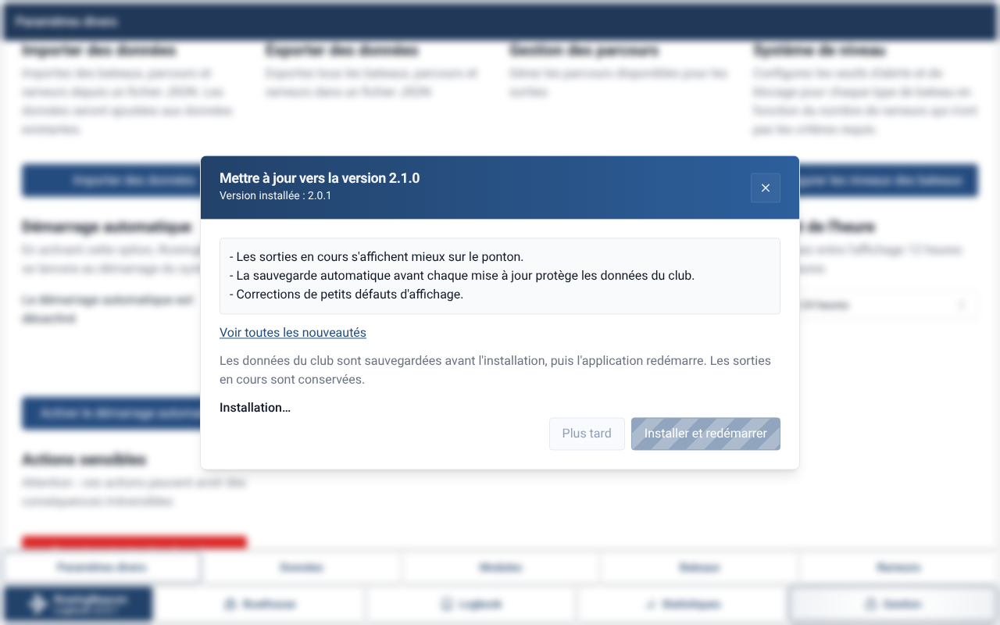
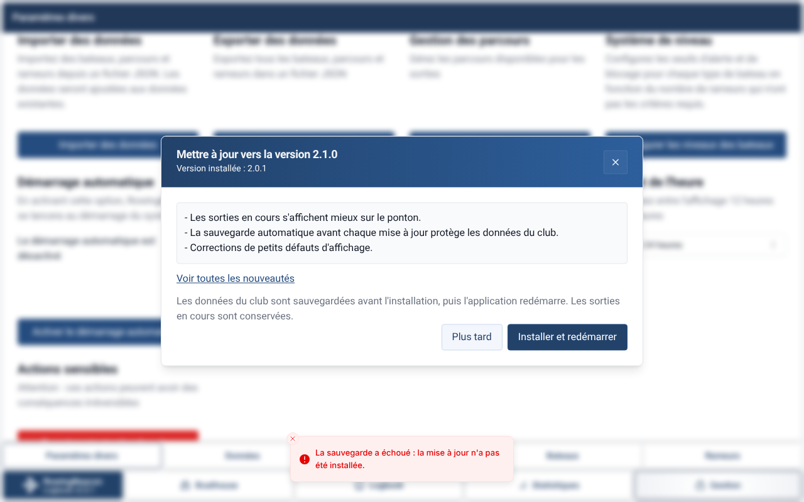

# Captures de la PR #5

Captures faites dans l'interface sans Tauri, avec une version 2.1.0 simulée et des données fictives (le plugin updater, la sauvegarde et la version de l'app sont remplacés par des faux).

**Message dans le hangar.** Un message en bas de l'écran annonce la nouvelle version, avec le bouton « Voir la mise à jour ».

**Gestion > Paramètres divers.** La section « Mises à jour » montre la version installée et le bouton « Rechercher une mise à jour ». Quand l'app est à jour, un message le confirme.

Quand une version est disponible, la section l'annonce et le bouton devient « Voir la mise à jour ».

**Boîte de mise à jour.** Elle montre les notes de version, le lien vers les nouveautés et le bouton « Installer et redémarrer ».

**Depuis le hangar.** Un clic sur « Installer et redémarrer » ferme la boîte le temps de saisir le mot de passe admin.

**Étapes de l'installation.** Les boutons sont bloqués pendant que la mise à jour avance.

**Échecs.** Le téléchargement coupé ramène la boîte à l'état normal avec un message d'erreur.

Si la sauvegarde échoue, rien n'est installé et un message le dit.

