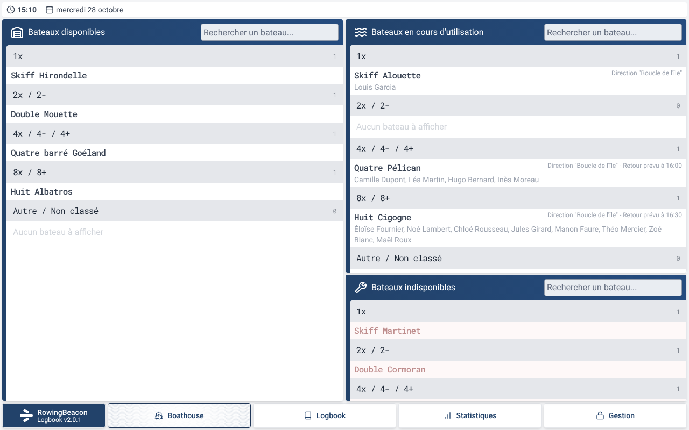
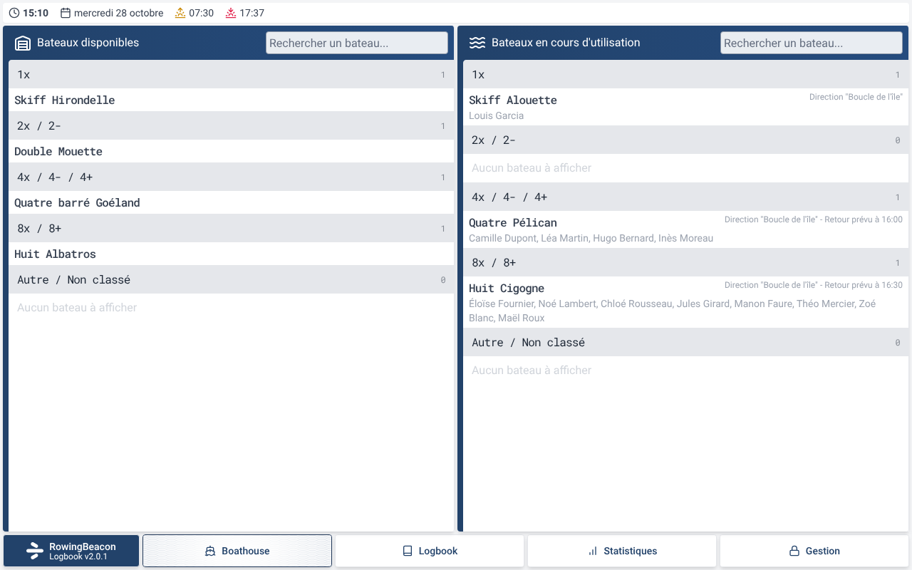
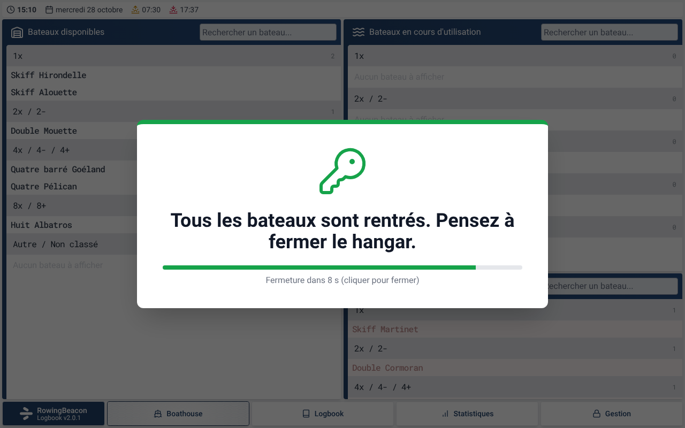
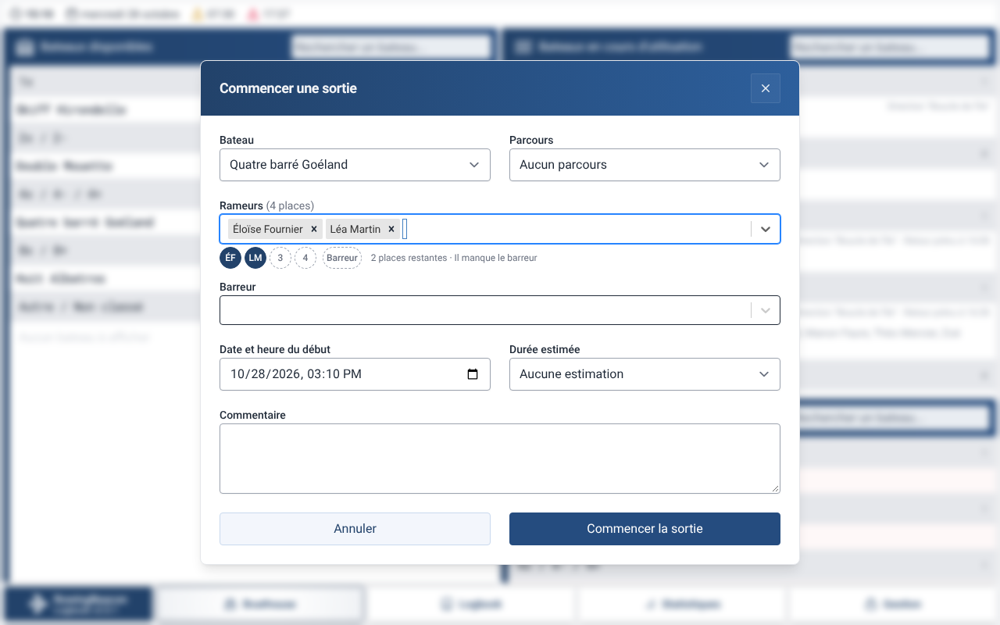
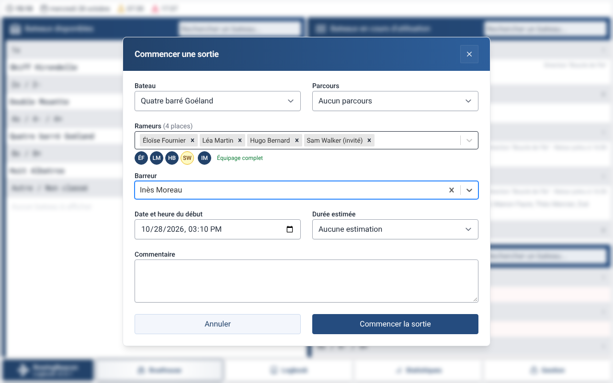
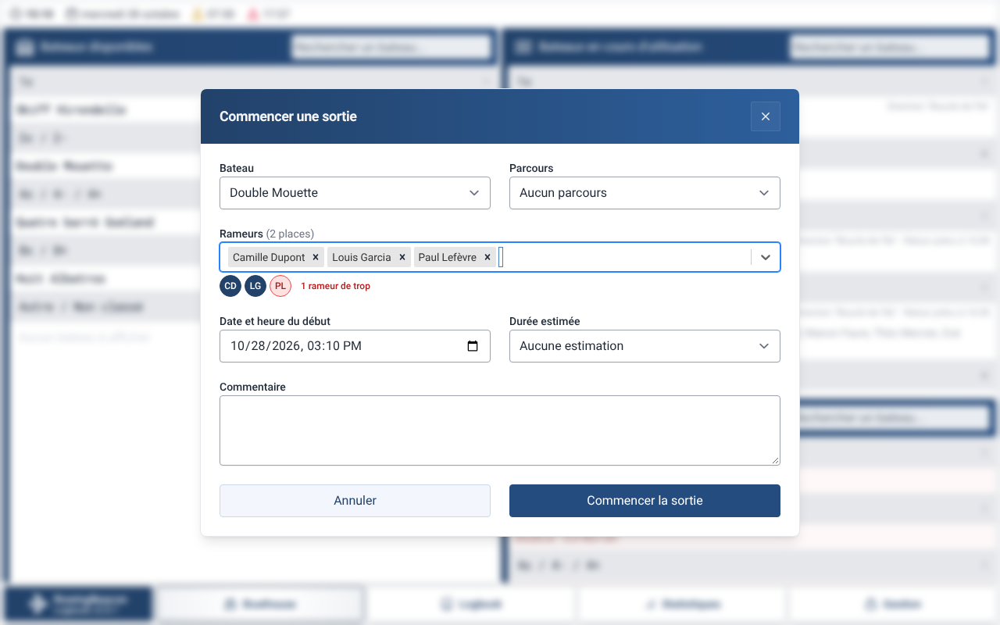
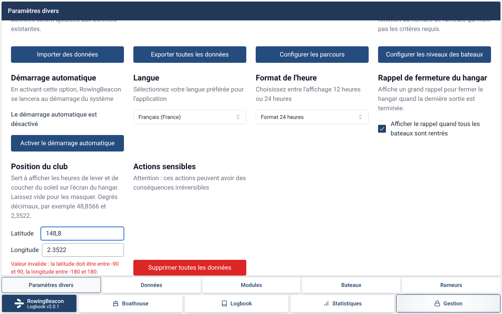
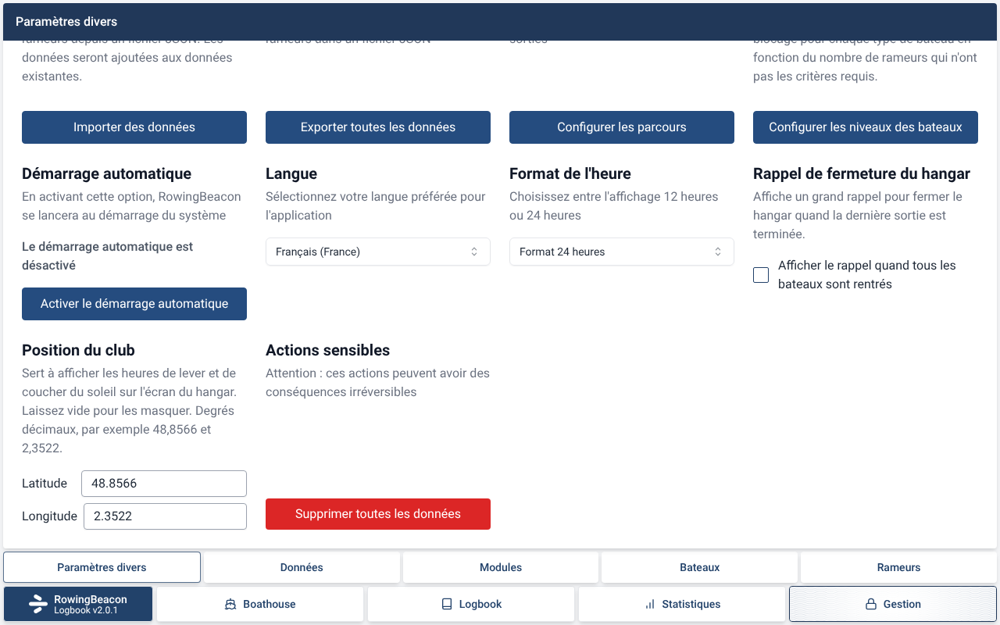

# Captures de la PR #6

Captures faites sur le code de la branche (commit `b8bb7db6`), dans l'interface sans Tauri, avec des données fictives, en français, le 28 octobre à 15 h 10 (heure de Paris) sauf mention contraire. Les images sont aussi dans `apps/logbook/docs/captures/pr-6/`.

**Ponton**

Le bandeau du haut montre l'heure, la date et le soleil (lever 07:30, coucher 17:37). Les bateaux en maintenance sont dans « Bateaux indisponibles », sous les bateaux sortis. « Huit Cigogne » est en maintenance mais sorti : il reste dans les sortis.

Tant que la position du club n'est pas saisie, le bandeau n'affiche que l'heure et la date.

Quand aucun bateau n'est indisponible, la liste n'apparaît pas et les bateaux sortis prennent toute la colonne.

À 18 h 30, après le coucher du soleil, l'avertissement « 3 sorties encore sur l'eau alors qu'il fait nuit » s'affiche juste après l'heure.

**Rappel « tous rentrés »**

Quand la dernière sortie est terminée, le rappel s'affiche en plein écran avec le compte à rebours de 10 s (ici, 8 s restantes).

**Places restantes au départ**

Un quatre barré avec 2 rameurs choisis : deux places remplies (initiales), deux places vides en pointillés, la case « Barreur » vide, et la ligne « 2 places restantes · Il manque le barreur ».

Le même bateau avec 4 rameurs dont un invité (case jaune) et un barreur choisi : « Équipage complet ».

Un double avec 3 rameurs : le rameur en trop est en rouge et la ligne dit « 1 rameur de trop ».

**Paramètres**

Dans « Paramètres divers », les deux nouvelles sections : « Rappel de fermeture du hangar » (case cochée par défaut) et « Position du club » (latitude et longitude).

Une latitude invalide (148,8) affiche un message d'erreur et ne remplace pas la position enregistrée.

La case du rappel décochée : le rappel ne s'affichera plus.
