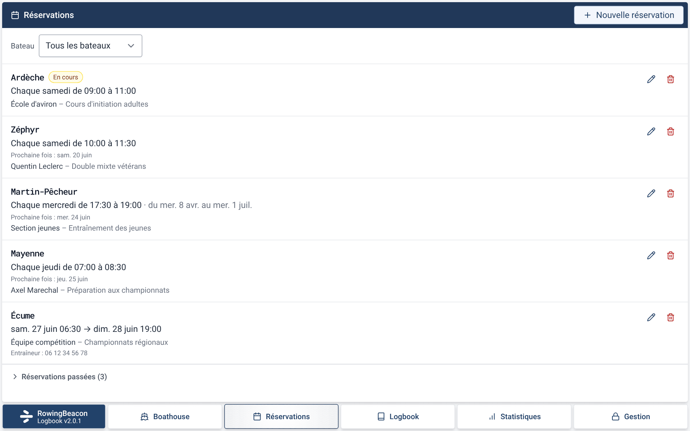
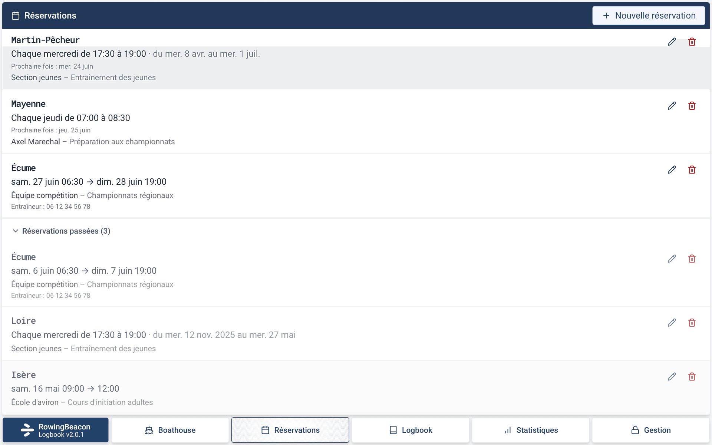
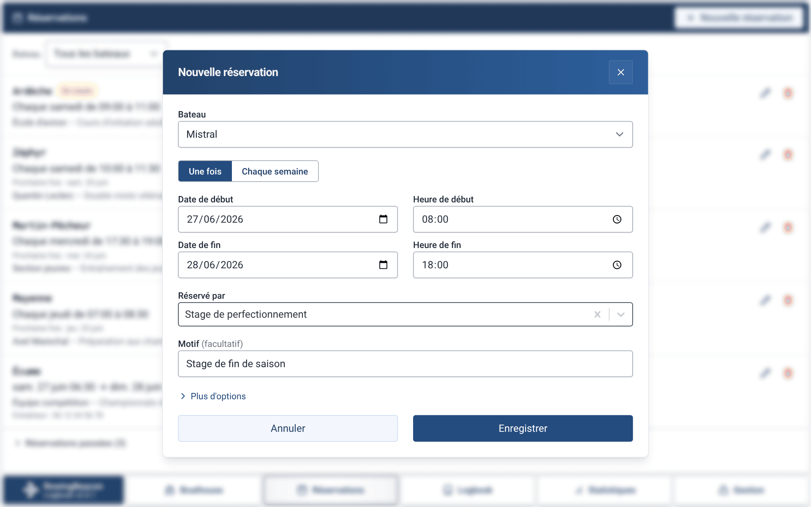
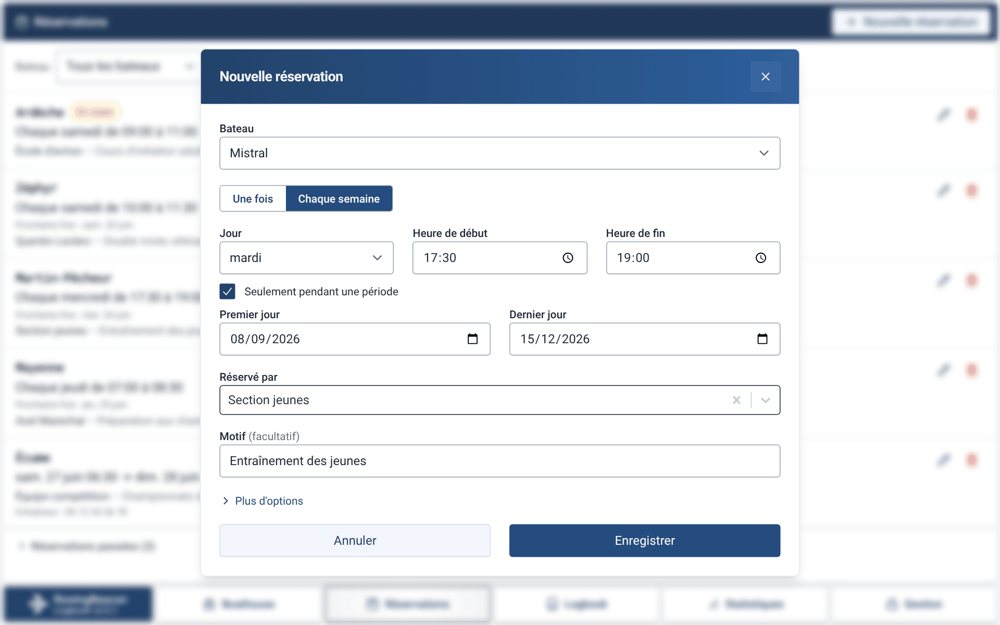
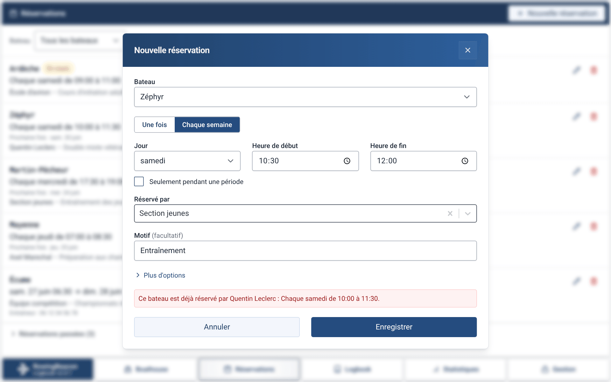
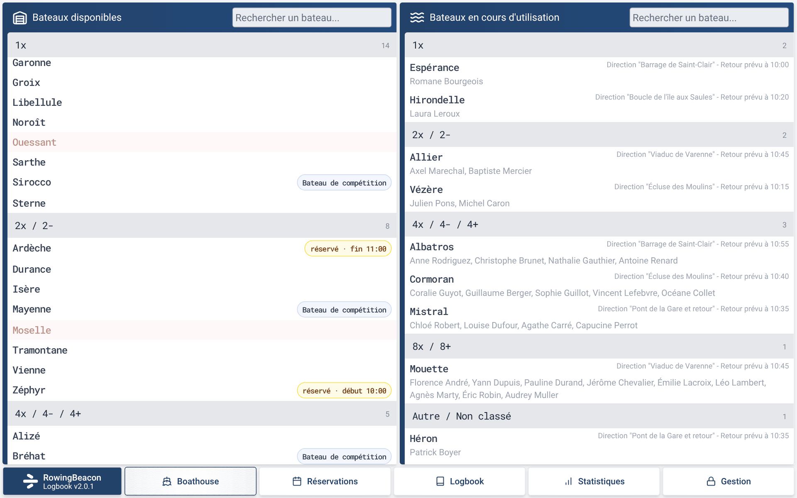
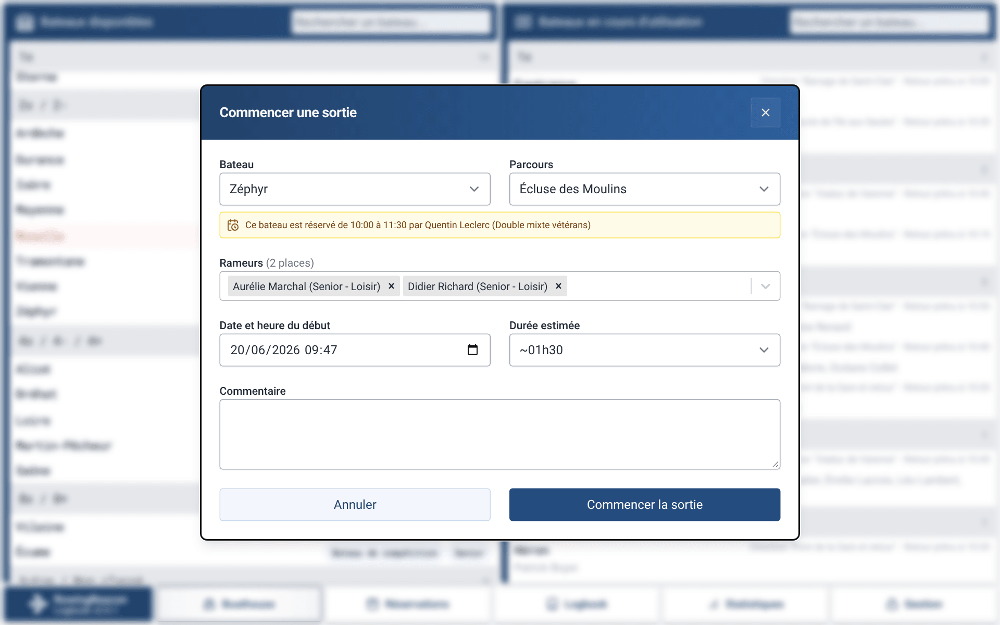
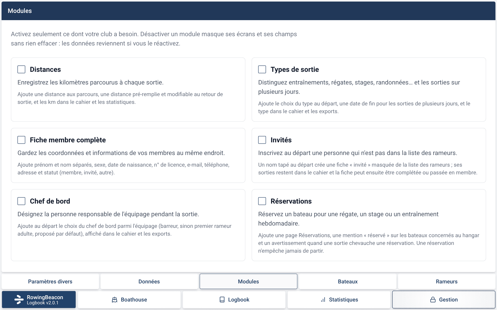
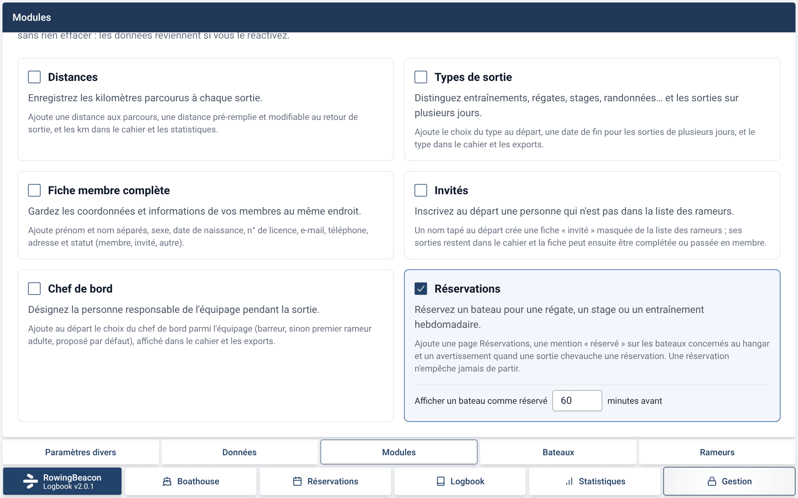

# Captures de la PR #7

Module Réservations. Captures faites dans l'interface sans Tauri, avec un club fictif (samedi 20 juin 2026 à 09:47, module Réservations activé).

## Onglet Réservations

L'onglet Réservations : une réservation « En cours » (Ardèche), puis les réservations à venir triées par prochaine occurrence, avec le filtre par bateau.

Le bas de la liste, avec la section « Réservations passées » dépliée.

## Formulaire

Réservation ponctuelle sur deux jours, avec un nom libre comme titulaire et un motif.

Réservation hebdomadaire (jour + créneau), limitée à une période.

Un créneau qui chevauche une réservation existante du même bateau est refusé, et le message nomme la réservation en conflit.

## Ponton et départ

Au ponton, les badges jaunes « réservé · fin 11:00 » (réservation en cours) et « réservé · début 10:00 » (réservation dans moins de 60 minutes), et l'onglet Réservations dans la barre.

Au départ d'une sortie sur un bateau réservé, l'avertissement jaune non bloquant indique l'horaire et le titulaire de la réservation.

## Gestion > Modules

Le module Réservations n'est pas activé : pas d'onglet Réservations dans la barre.

Une fois activé, l'onglet apparaît et le réglage « Afficher un bateau comme réservé … minutes avant » (60 par défaut) s'affiche dans la carte du module.

