# Captures de la PR #8

Captures faites dans l'interface sans Tauri, avec des données fictives (club d'aviron imaginaire, base SQLite en mémoire, date fixée au 28/10/2026 à 11h, fuseau Europe/Paris). Les champs date et heure s'affichent au format du navigateur de test (anglais américain), pas celui de l'application compilée.

## Sortie déjà faite

Le ponton : le bouton « Sortie déjà faite » est dans l'en-tête des bateaux disponibles.

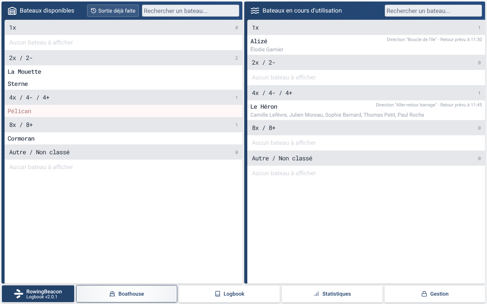

L'éditeur en mode « Sortie déjà faite », rempli : bateau, armement, parcours, quatre rameurs et un barreur, chef de bord, horaires, distance, commentaire.

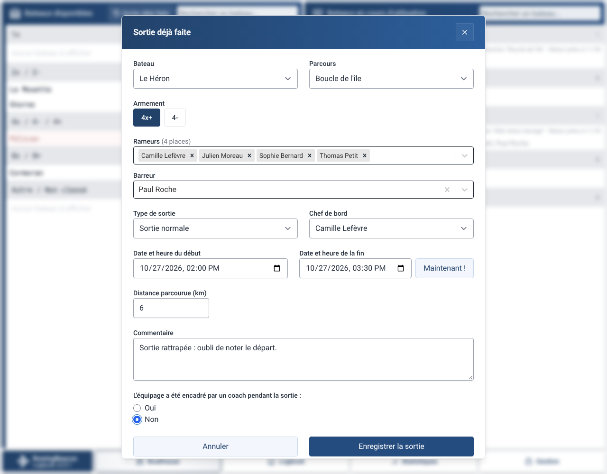

Après « Enregistrer la sortie » : la fenêtre se ferme et un message confirme l'ajout à l'historique.

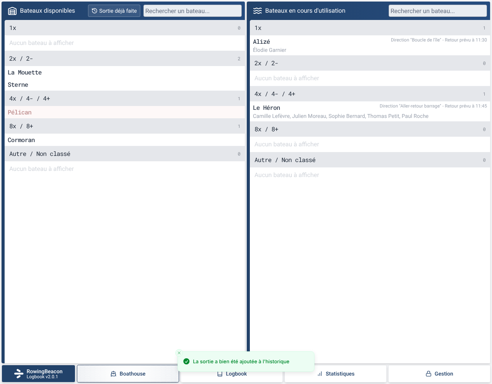

## Corriger une sortie terminée (cahier)

Le cahier : le bouton « Sortie déjà faite » est aussi dans l'en-tête de l'historique, et chaque sortie a un crayon à côté de la corbeille.

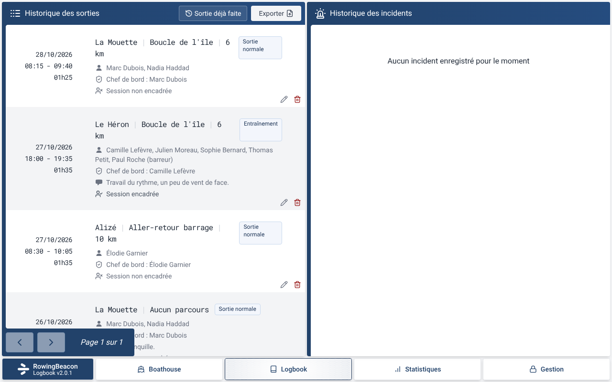

Le crayon demande le mot de passe admin, comme la suppression.

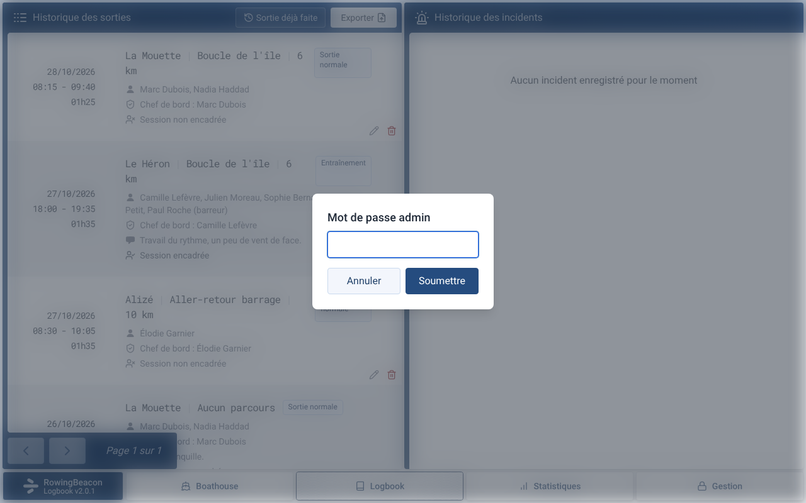

L'éditeur d'une sortie terminée, avec ses valeurs enregistrées.

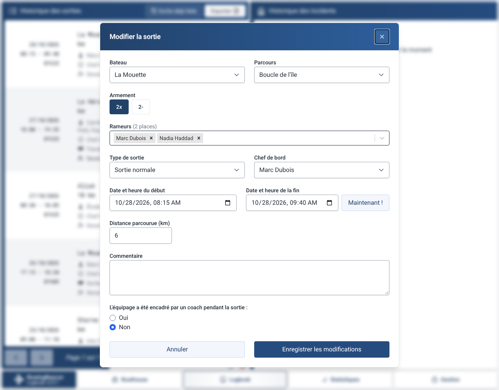

## Corriger une sortie en cours

La fenêtre de retour d'une sortie en cours, avec le lien « Modifier la sortie » en bas.

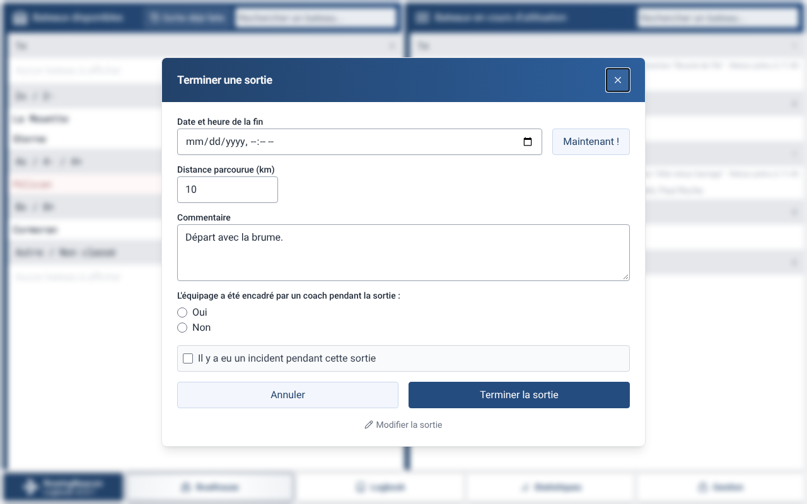

L'éditeur d'une sortie en cours : retour prévu au lieu de la fin, sans mot de passe admin.

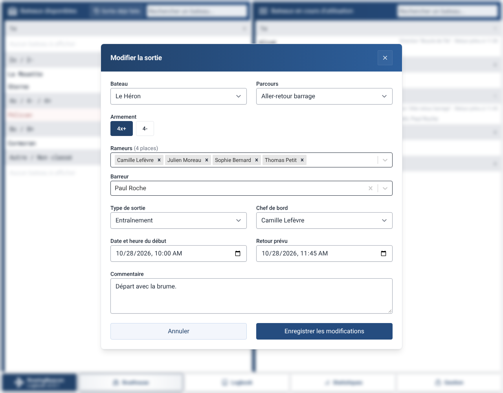

## Erreurs qui bloquent l'enregistrement

Formulaire vide : bateau et réponse sur l'encadrement obligatoires.

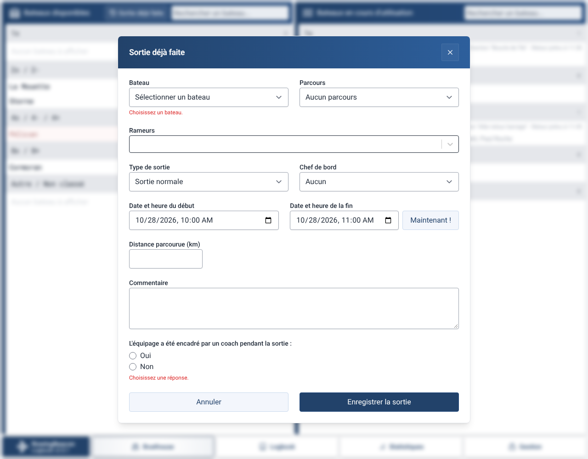

Fin avant le début.

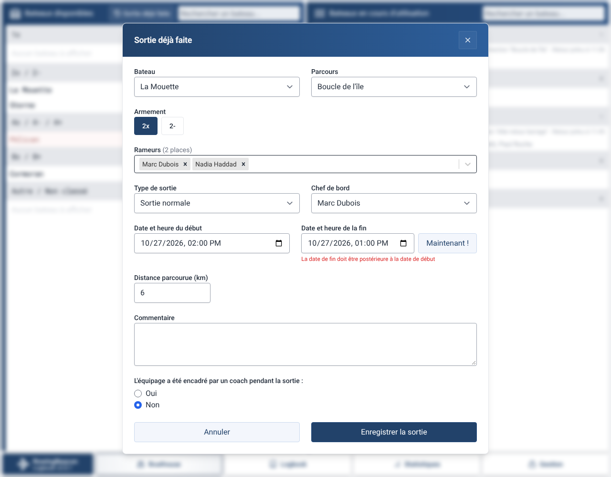

Aucun rameur.

Début dans le futur (une sortie déjà faite ne peut pas commencer après maintenant).

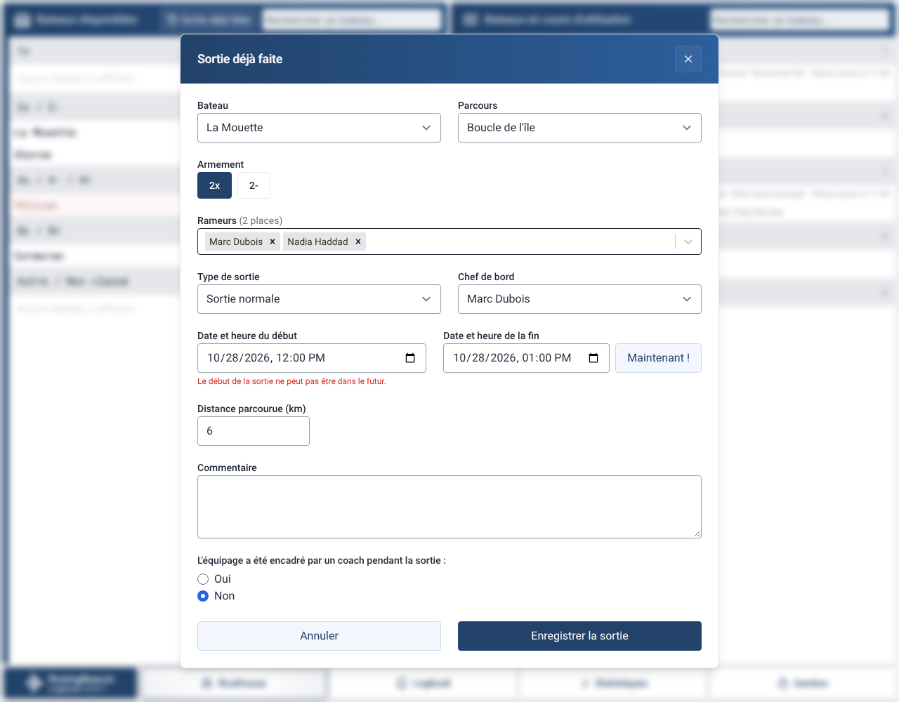

Correction d'une sortie en cours vers un bateau qui est déjà sur une autre sortie en cours.

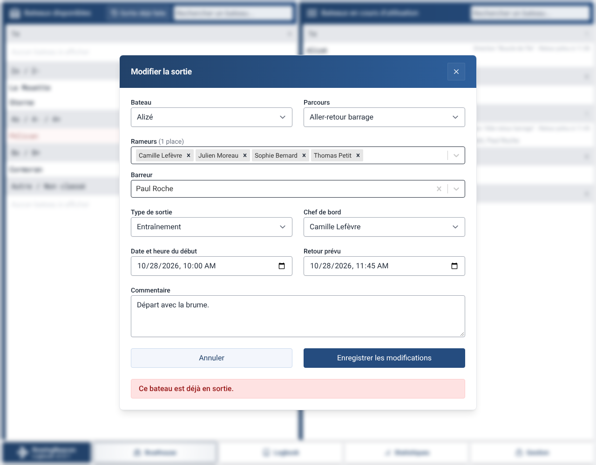

## Alertes avec « Enregistrer quand même »

Nombre de rameurs différent du nombre de places du bateau.

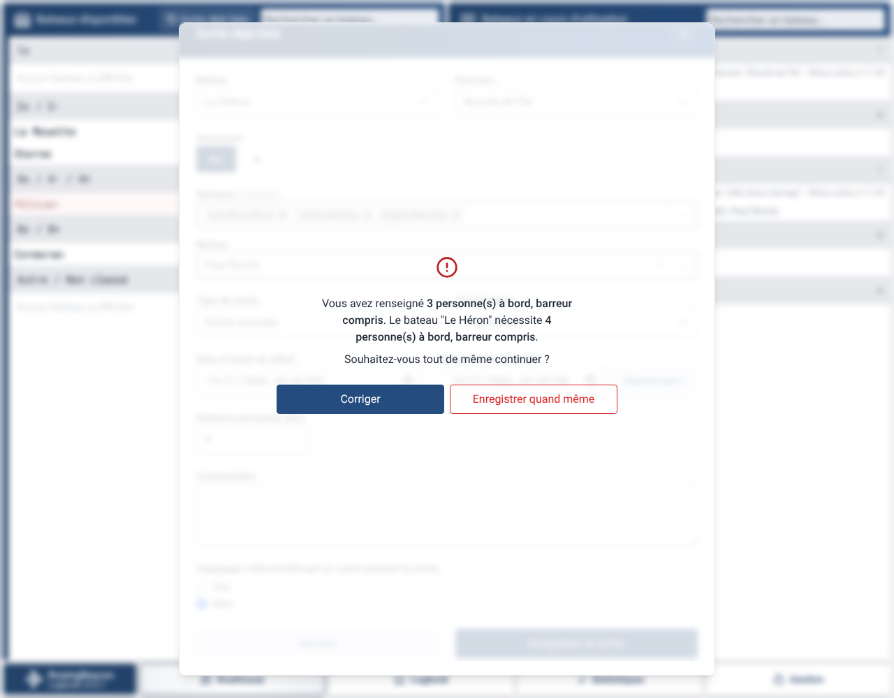

Bateau et rameurs déjà sur une autre sortie aux mêmes horaires.

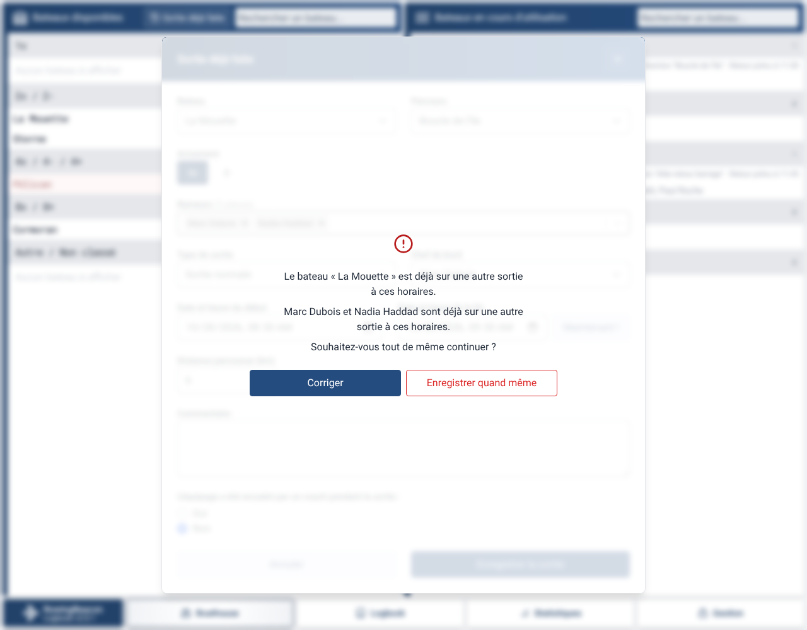
