# Captures de la PR #9

Module Avaries. Captures faites avec les vrais composants du Logbook, sans Tauri, sur un club fictif (français, samedi 20 juin 2026, 09h47).

## Ponton

Le ponton : un indicateur sur les bateaux avec une avarie non bloquante (gris pour « Utilisable », jaune pour « Précaution »), et la raison affichée pour un bateau hors service (Ouessant).

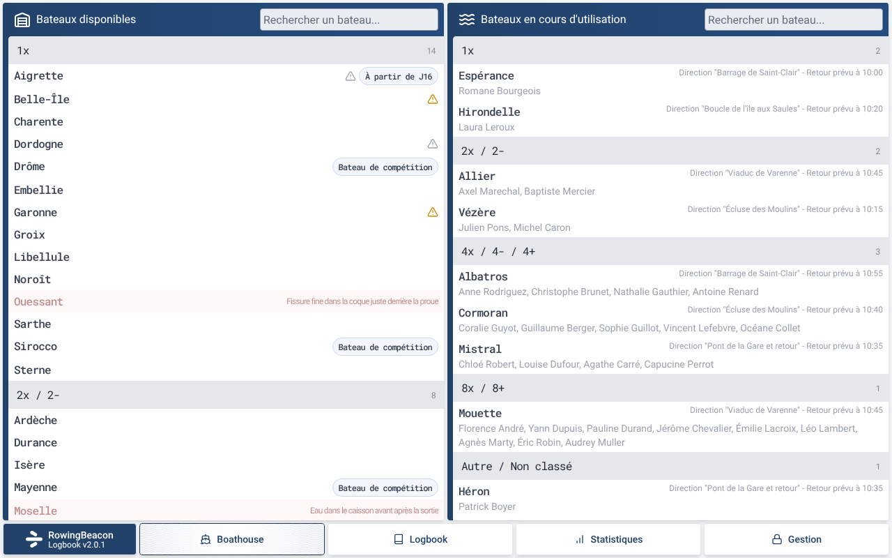

Au départ, l'encadré jaune « Avaries ouvertes sur ce bateau » liste les avaries sans bloquer la sortie.

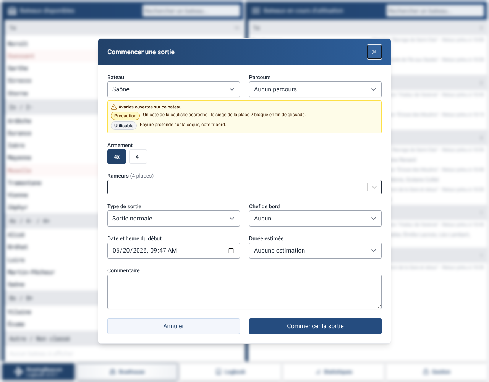

En fin de sortie, la case « Le bateau est endommagé » demande la gravité de l'avarie.

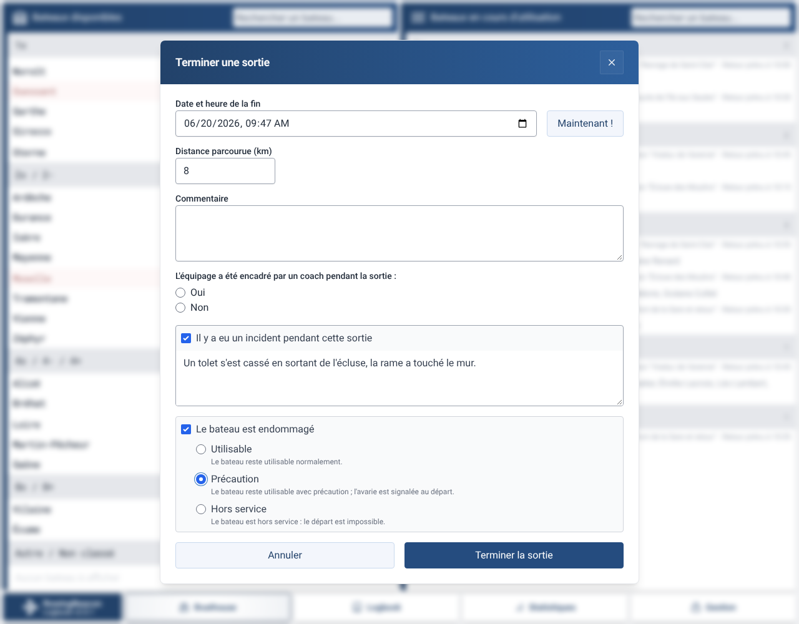

Sans le module, quand on coche un incident, une suggestion discrète propose d'activer « Avaries ».

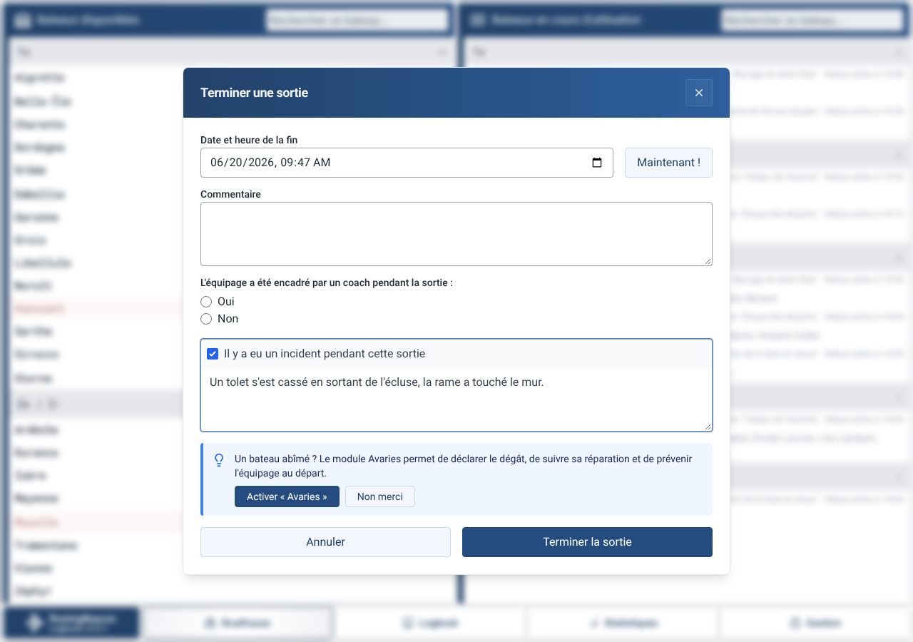

## Cahier

L'onglet Avaries du Cahier, filtre « Ouvertes » : gravité, déclarant, « Modifier » et « Marquer réparée ».

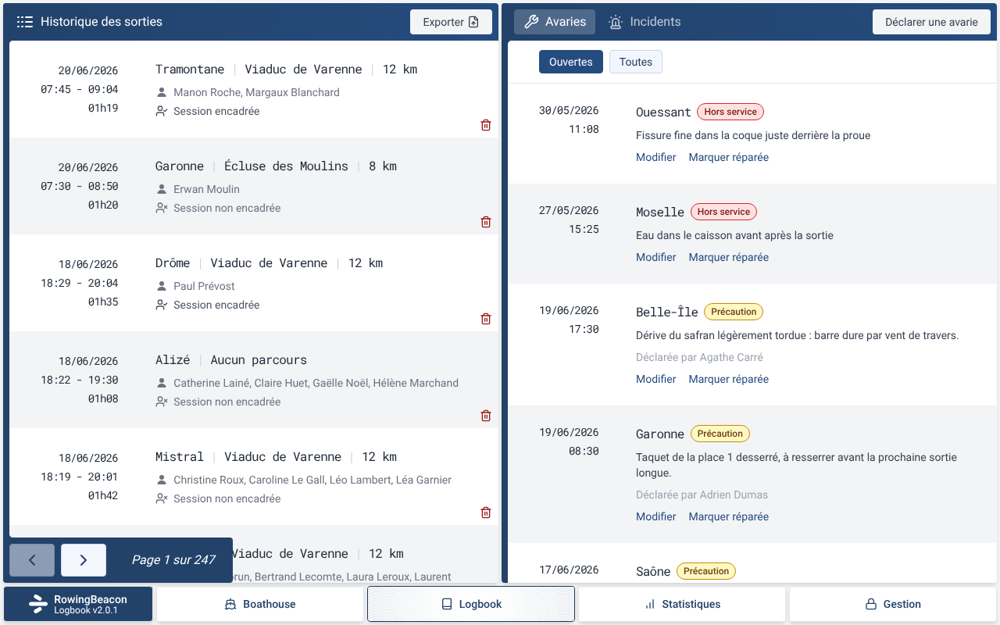

Le filtre « Toutes » garde l'historique : date, réparateur, note et coût de la réparation, et « Rouvrir ».

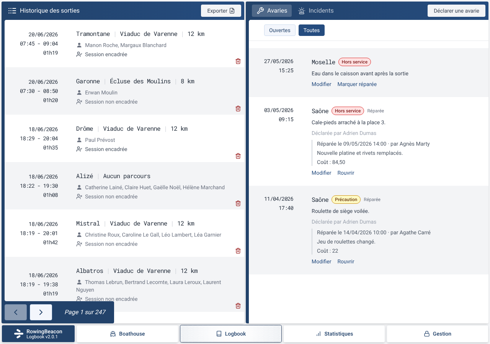

L'onglet Incidents, avec « Déclarer une avarie » sur les incidents qui n'en ont pas encore.

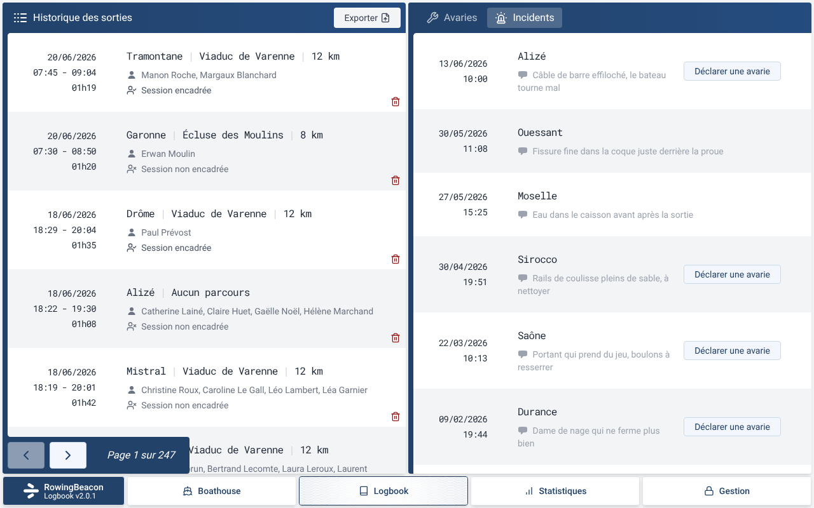

## Formulaires

Le formulaire de déclaration : bateau, gravité avec son explication, description, déclarant et date.

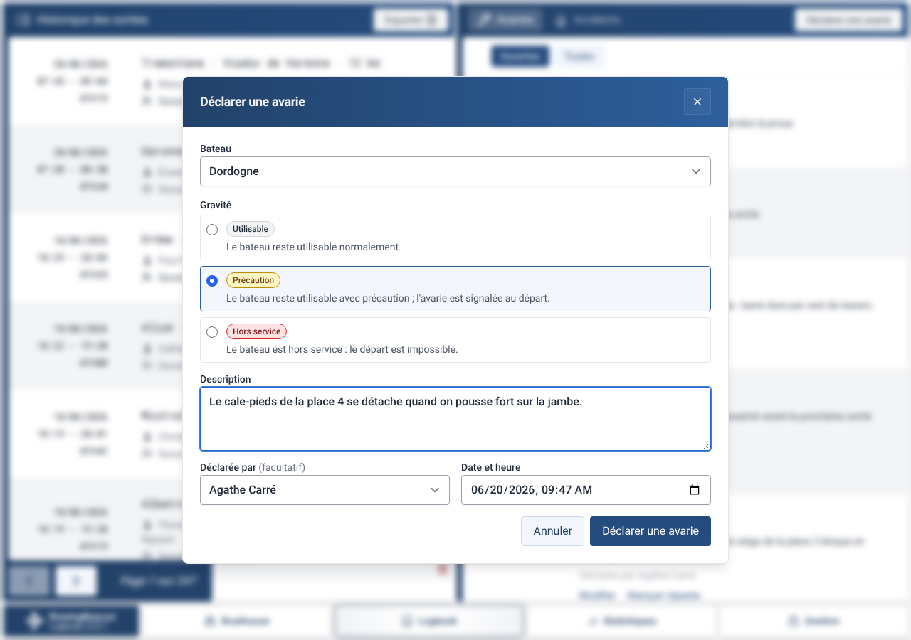

Depuis un incident, le bateau est verrouillé, et la description et la date viennent de l'incident.

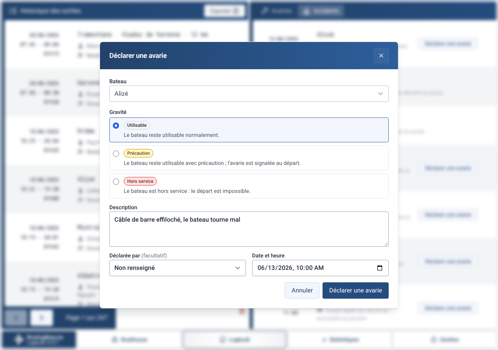

Le formulaire « Marquer l'avarie comme réparée » : date, réparateur, note et coût.

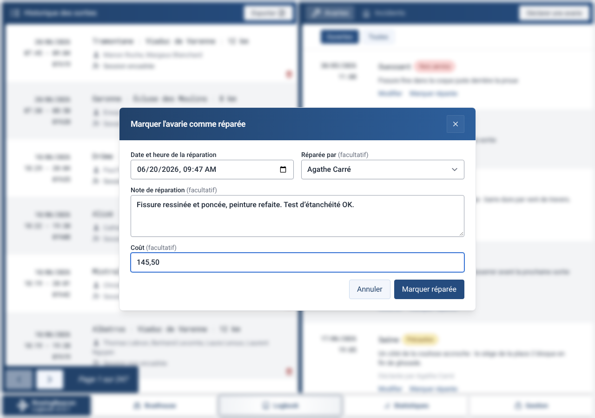

## Gestion

La liste des bateaux a un badge de gravité (« Utilisable », « Précaution », « Hors service »).

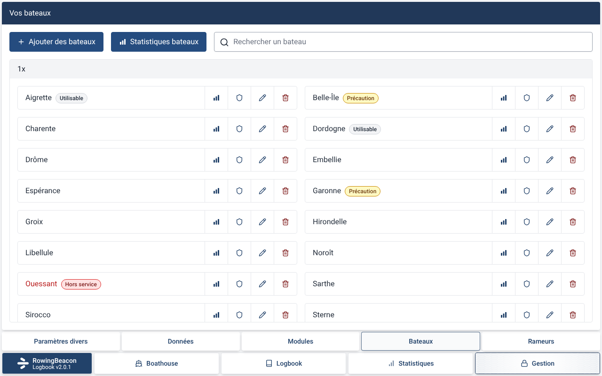

La fiche bateau liste les avaries ouvertes, avec « Marquer réparée » et « Déclarer une avarie ».

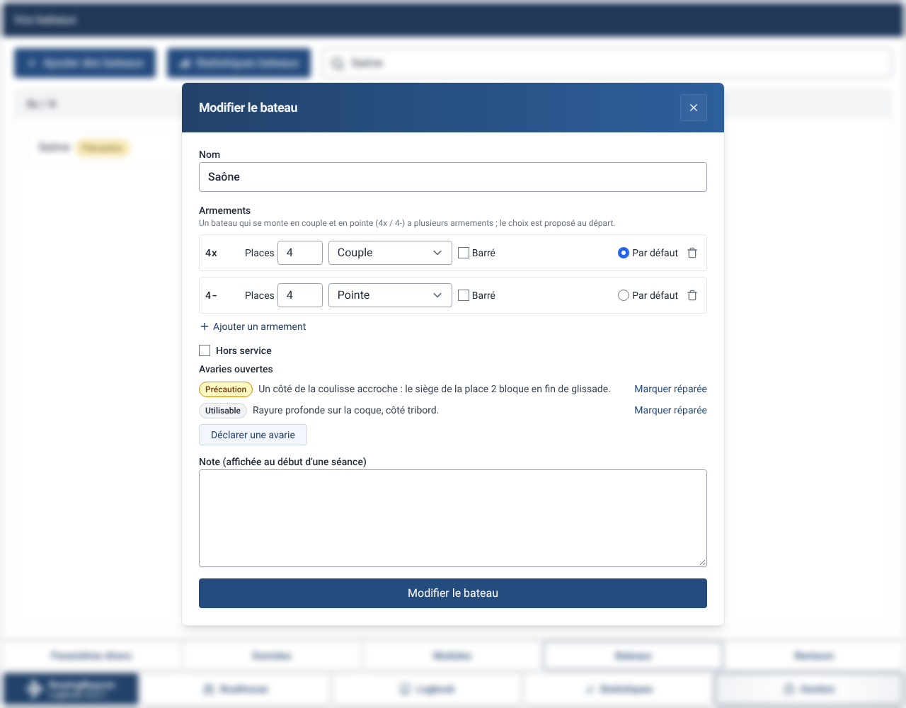

La case « Hors service » est cochée et verrouillée tant qu'une avarie hors service est ouverte : il faut la marquer réparée.

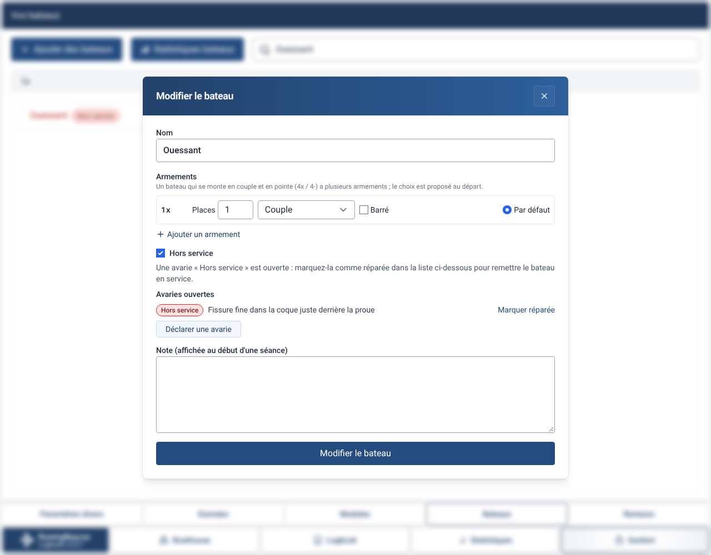

Les statistiques d'un bateau montrent l'historique des avaries par date, réparées comprises, puis les incidents.

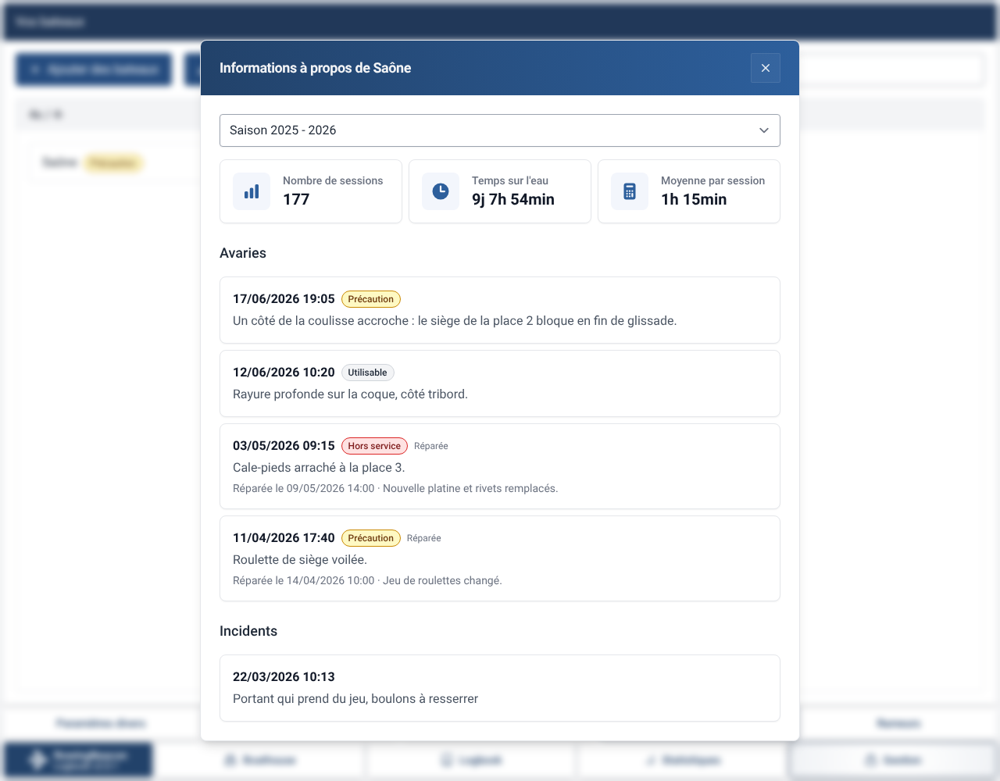
