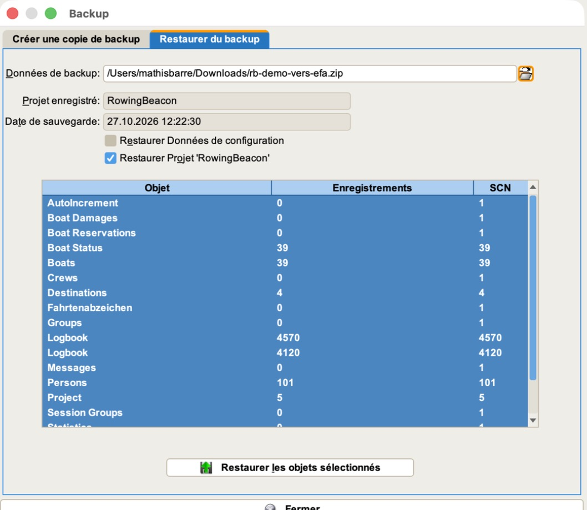
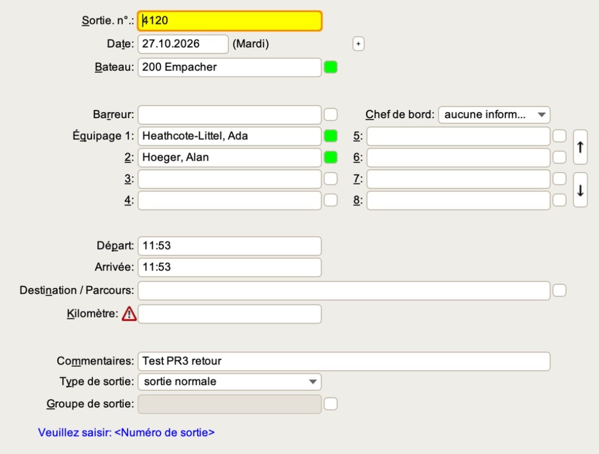
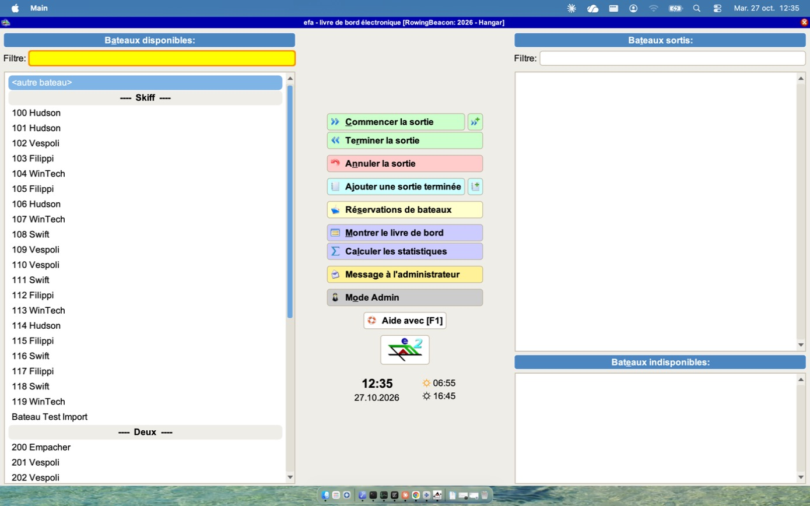
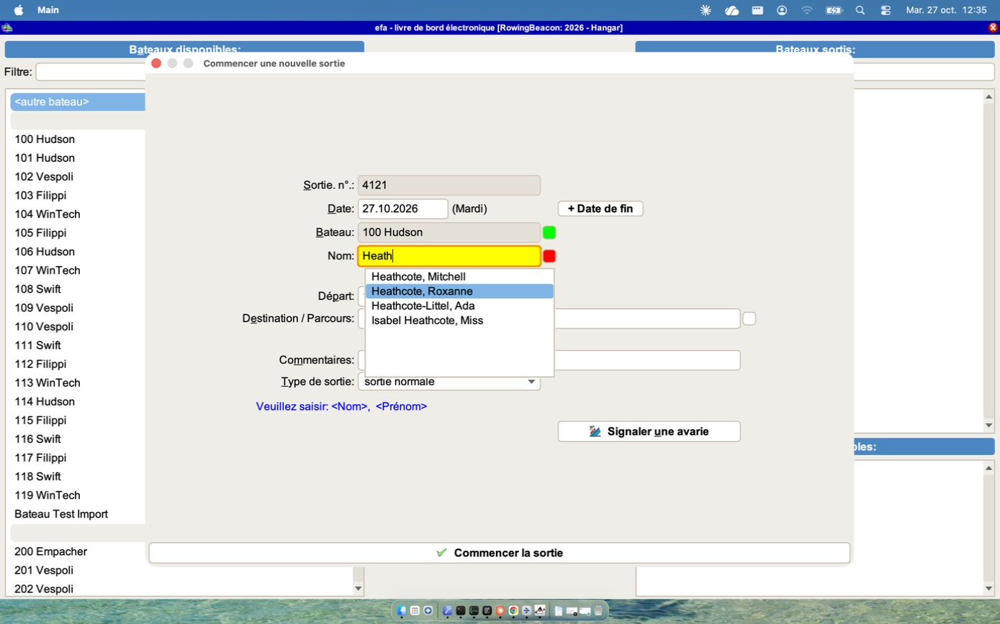
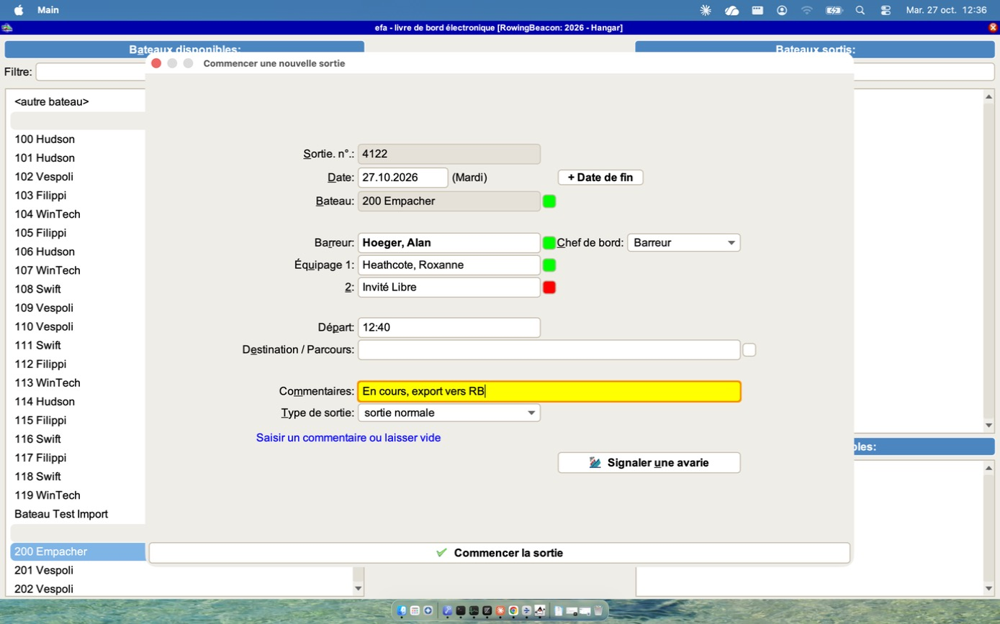
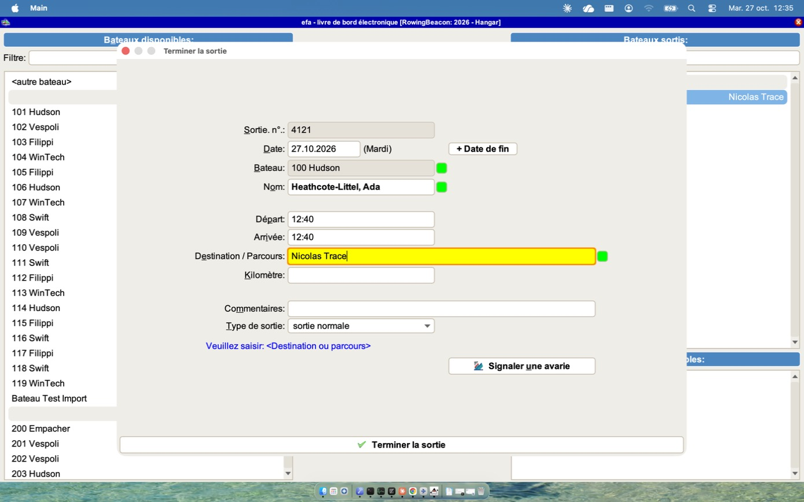
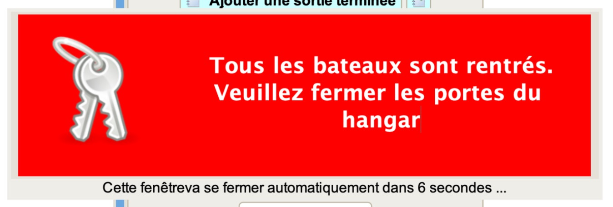

# Idées à reprendre d'efa2, vues en vrai

Notes prises en utilisant efa 2.5.3_17 (11.10.2026) sur macOS, avec Java 17, pendant les tests d'aller-retour entre Rowing Beacon et efa2. Jusqu'ici, le modèle de données d'efa2 avait été étudié à partir de ses fichiers, jamais en manipulant l'application.

Chaque idée dit ce qu'efa fait, pourquoi c'est bien vu et ce que Rowing Beacon pourrait en reprendre. Les captures sont dans `img/`.

## Idées

### Voir ce que contient une sauvegarde avant de la restaurer

Quand on choisit un fichier, efa affiche aussitôt le projet, la date de la sauvegarde et un tableau objet par objet : bateaux, personnes, destinations, chaque cahier de sorties avec son nombre d'enregistrements. On coche ce qu'on veut restaurer, y compris la configuration à part du projet.

- **Pourquoi c'est bien** : on vérifie qu'on tient la bonne sauvegarde (le bon club, la bonne date, « 8 690 sorties, ça colle ») avant d'écraser quoi que ce soit, et on peut ne reprendre qu'une partie.
- **Pour Rowing Beacon** : la fenêtre de confirmation de restauration ne donne que la date. Y ajouter les nombres (bateaux, rameurs, parcours, sorties, sortie la plus récente) ne coûte qu'une lecture de la copie, déjà ouverte par la restauration. La restauration sélective est déjà notée dans `A-FAIRE-PLUS-TARD.md` ; ce tableau en serait l'écran naturel.

### Montrer d'un coup d'œil ce qui est reconnu et ce qui manque

Dans le formulaire de sortie, chaque champ qui désigne une fiche (bateau, barreur, équipiers, destination) a un petit carré à droite : vert quand le nom tapé correspond à une fiche connue, vide sinon (nom libre). Un triangle rouge signale un champ attendu mais vide (ici les kilomètres). La date est suivie du jour de la semaine (« Mardi »), et une ligne d'aide en bas dit ce qu'il faut saisir dans le champ actif.

- **Pourquoi c'est bien** : à la relecture d'une sortie, on voit tout de suite qui est un membre et qui est un nom libre (un invité, une faute de frappe), et ce qui manque, sans ouvrir chaque fiche. Le jour de la semaine évite les erreurs de date quand on saisit après coup.
- **Pour Rowing Beacon** : dans le détail d'une sortie et dans le cahier, marquer les invités et noms libres autrement que les membres, et signaler les sorties incomplètes (distance manquante quand le module Distances est actif). Afficher le jour de la semaine à côté des dates saisies à la main.

### Un écran hangar en trois listes, avec l'heure et le soleil

L'écran du hangar montre trois listes en permanence : bateaux disponibles (classés par type, avec un filtre en haut), bateaux sortis (avec la destination à droite), bateaux indisponibles. Les actions sont au centre, en gros boutons colorés par famille : sortir / rentrer / annuler en vert et rouge, « Ajouter une sortie terminée » en bleu clair, réservations, cahier, statistiques, « Message à l'administrateur ». En dessous : l'heure, la date, et les heures de **lever et coucher du soleil** du jour (06:55 / 16:45).

- **Pourquoi c'est bien** : depuis la porte du hangar, on voit d'un coup d'œil ce qui est sur l'eau et ce qui est en réparation. Le coucher du soleil répond à la vraie question avant de partir (« ai-je le temps de faire mon tour ? »), et c'est une règle de sécurité dans beaucoup de clubs. « Ajouter une sortie terminée » couvre l'oubli courant : on est parti sans noter.
- **Pour Rowing Beacon** : afficher lever et coucher du soleil près de l'heure (calcul local à partir des coordonnées du club, sans réseau). Envisager une colonne « indisponibles » séparée plutôt que des lignes grisées au milieu des disponibles. Un bouton « sortie déjà faite » qui ouvre le formulaire avec départ et retour à saisir. Un « message au responsable » depuis le hangar, distinct d'une avarie.

### Un formulaire de départ qui s'adapte au bateau

Quand on choisit le bateau d'abord, le formulaire prend sa forme : un skiff n'a qu'un champ « Nom » ; un deux barré a « Barreur », « Équipage 1 », « 2 » et un « Chef de bord » (rempli automatiquement avec « Barreur » une fois le barreur saisi). La date est suivie du jour de la semaine, le n° de sortie est déjà attribué. Les suggestions de noms cherchent **n'importe où dans le nom** (« Heath » trouve « Isabel Heathcote, Miss ») et le carré à droite passe du rouge (pas encore reconnu) au vert (fiche trouvée). Un nom libre reste en rouge mais est accepté. L'heure de départ proposée est arrondie aux 5 minutes suivantes.

- **Pourquoi c'est bien** : pas de place vide à deviner, pas de barreur oublié dans un bateau barré. Le rouge/vert dit tout de suite si on a tapé un membre ou un invité.
- **Pour Rowing Beacon** : Rowing Beacon connaît déjà le barreur et avertit quand le nombre de rameurs ne correspond pas aux places. efa va plus loin en montrant une case par place dès le choix du bateau : on voit ce qui reste à remplir au lieu d'être averti après coup. À reprendre aussi : le carré « membre reconnu » / « nom libre » pendant la saisie, et la recherche par sous-chaîne dans les noms.

### Au retour, ne demander que ce qui manque

Le formulaire de retour reprend la sortie et n'ajoute que « Arrivée » et « Kilomètre » ; le champ actif est surligné en jaune et la ligne bleue dit quoi saisir (« Veuillez saisir : <Destination ou parcours> »). Les kilomètres se tapent en nombre et s'affichent « 8 km ».

- **Pour Rowing Beacon** : la fin de sortie peut rester un écran court, centré sur ce qui manque (heure de retour, distance si le module est actif, remarque, avarie), avec une aide d'une ligne sous le champ actif.

### « Tous les bateaux sont rentrés »

Quand le dernier bateau sorti est rentré, efa affiche quelques secondes un grand bandeau rouge avec des clés : « Tous les bateaux sont rentrés. Veuillez fermer les portes du hangar ». Il se ferme tout seul (compte à rebours affiché).

- **Pourquoi c'est bien** : c'est un vrai geste de sécurité (fermer le hangar, savoir que plus personne n'est sur l'eau), déclenché au bon moment, sans rien à cliquer.
- **Pour Rowing Beacon** : un message du même genre à la fin de la dernière sortie en cours, désactivable dans les réglages. Il pourrait aussi rappeler les sorties encore ouvertes après le coucher du soleil.
